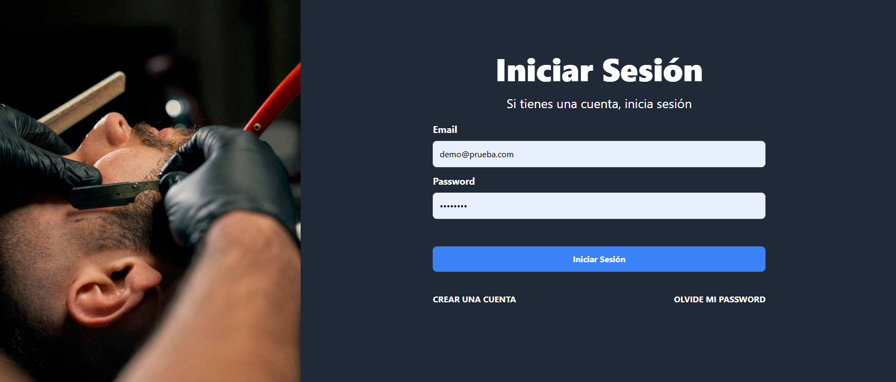

# 💈 AppSalon – Frontend

Interfaz web de **AppSalon**, una aplicación para reservar citas en un salón de belleza y barbería. Los clientes crean una cuenta, eligen hasta dos servicios, seleccionan fecha y hora disponibles y gestionan sus reservaciones; el administrador consulta todas las citas próximas.

Está construida con **Vue 3**, **Pinia**, **Vue Router**, **FormKit** y **Tailwind CSS**, y consume la API del backend hecho con Node.js y Express. Forma parte de un proyecto **MEVN** (MongoDB, Express, Vue, Node).

> 🔗 El backend de este proyecto está en [appsalon-backend](https://github.com/SuemyDzib/appsalon-backend).



## ✨ Características

### Cuenta de usuario

- **Registro** con validación de formularios y confirmación de cuenta por email.
- **Inicio y cierre de sesión**; el token JWT se guarda en LocalStorage.
- **Recuperación de contraseña** mediante un enlace enviado por email.

### Reservaciones

- **Selección de servicios** con un máximo de dos por cita y cálculo automático del total.
- **Calendario de reservación** que solo permite elegir días hábiles (lunes a viernes) a partir de hoy y hasta el mes siguiente.
- **Horarios de 10:00 a 19:00**, con los horarios ya ocupados deshabilitados automáticamente.
- **Mis citas**: listado de las citas próximas, con opción de editarlas o cancelarlas.
- **Notificaciones** de éxito y error.

### Administración

- **Panel de administración** con todas las citas próximas, el cliente que las reservó y los servicios elegidos.
- **Rutas protegidas**: el área de reservaciones requiere sesión iniciada y el panel requiere permisos de administrador.

## 🛠️ Tecnologías

- [Vue 3](https://vuejs.org/) con Composition API y `<script setup>`
- [Pinia](https://pinia.vuejs.org/) para el manejo del estado
- [Vue Router](https://router.vuejs.org/) con guardas de navegación
- [FormKit](https://formkit.com/) para formularios y validaciones
- [Tailwind CSS](https://tailwindcss.com/) y [Vue Tailwind Datepicker](https://vue-tailwind-datepicker.com/)
- [Axios](https://axios-http.com/) para las peticiones HTTP
- [date-fns](https://date-fns.org/) para el manejo de fechas
- [vue-toast-notification](https://github.com/ankurk91/vue-toast-notification) para las notificaciones
- [Vite](https://vitejs.dev/) como herramienta de desarrollo y build

## 📋 Requisitos

- [Node.js](https://nodejs.org/) 18 o superior
- El [backend de AppSalon](https://github.com/SuemyDzib/appsalon-backend) corriendo localmente o desplegado

## 🚀 Instalación y uso

1. Clona el repositorio:

   ```bash
   git clone https://github.com/SuemyDzib/appsalon-frontend.git
   cd appsalon-frontend
   ```

2. Instala las dependencias:

   ```bash
   npm install
   ```

3. Crea un archivo `.env.local` a partir del ejemplo e indica la URL de la API, incluyendo `/api` al final:

   ```bash
   cp .env.example .env.local
   ```

   ```env
   VITE_API_URL=http://localhost:4000/api
   ```

4. Inicia el servidor de desarrollo:

   ```bash
   npm run dev
   ```

5. Abre `http://localhost:5173` en tu navegador.

> Asegúrate de que la variable `FRONTEND_URL` del backend coincida con la URL del frontend; de lo contrario, las peticiones serán bloqueadas por CORS y los enlaces de los correos no funcionarán.

### Scripts

| Comando           | Descripción                                              |
| ----------------- | -------------------------------------------------------- |
| `npm run dev`     | Inicia el servidor de desarrollo con recarga en caliente |
| `npm run build`   | Genera la versión de producción en la carpeta `dist/`    |
| `npm run preview` | Sirve localmente la versión de producción generada       |

## 👤 Autor

Desarrollado por **Suemy Dzib** – [@SuemyDzib](https://github.com/SuemyDzib) a través del curso de Udemy impartido por Juan de la Torre.